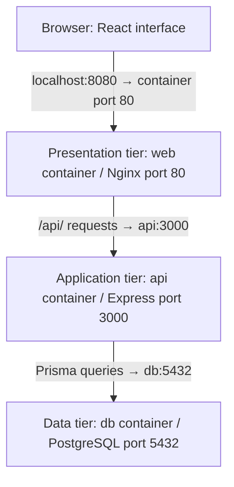

# TaskBox project structure

I split my code into folders based on what each part does. This makes the code easier to find and change. I use layered architecture in my backend. My frontend also has separate parts for the screen, data handling and API requests.

I use code layers to organize my folders. I use Docker containers to run my web server, API and database separately. These are two different parts of my project.

## My three-tier application diagram



I open `http://localhost:8080` in my browser. Nginx sends the built React files to the browser. React then runs in the browser. When React sends an API request, Nginx forwards it to Express. Express uses Prisma to read or change PostgreSQL data. The response returns through Express and Nginx to the browser.

The arrows show requests going toward the database. The responses travel back in the opposite direction. The three containers use `taskbox-net`. Only Nginx has a published host port. Cloudinary is an optional external image service and is not one of these three tiers.

## My project folders

```text
taskbox/
├── frontend/
│   ├── src/
│   │   ├── pages/
│   │   ├── components/
│   │   ├── hooks/
│   │   ├── services/
│   │   ├── context/
│   │   ├── types/
│   │   ├── utils/
│   │   ├── App.tsx
│   │   ├── main.tsx
│   │   └── index.css
│   ├── Dockerfile
│   └── nginx.conf
├── backend/
│   ├── src/
│   │   ├── routes/
│   │   ├── controllers/
│   │   ├── services/
│   │   ├── repositories/
│   │   ├── middlewares/
│   │   ├── mappers/
│   │   ├── integrations/
│   │   ├── config/
│   │   ├── types/
│   │   ├── utils/
│   │   ├── db.ts
│   │   └── index.ts
│   ├── prisma/schema.prisma
│   └── Dockerfile
├── docs/
│   ├── project-structure.md
│   └── docker-explanation.md
├── docker-compose.yml
├── .env.example
└── README.md
```

## My frontend structure

I use TypeScript, React, Vite and Tailwind CSS for my frontend.

| File or folder | Purpose |
| --- | --- |
| `main.tsx` | Starts React and sets up shared data and tools |
| `App.tsx` | Selects the main view and manages the open card |
| `pages/` | Contains board, table, shared-card and System views |
| `components/` | Contains reusable interface parts such as cards, dialogs and the header |
| `hooks/` | Contains shared code for loading and changing data |
| `services/` | Sends HTTP requests to the backend |
| `context/` | Shares login status, user details and account actions |
| `types/` | Stores TypeScript interfaces and types by feature |
| `utils/` | Contains helpers for dates, filtering, formatting and board updates |
| `index.css` | Contains shared styles, dropdown arrows and keyboard focus styles |

The usual data flow is:

```text
Page or component → React Query hook/mutation → frontend service
                                                 ↓
                                            Express API
```

I use React Query to load data and keep a saved copy, called a cache. It can refresh the data after I make changes. My pages, components and login context can use the services. I put repeated logic in custom hooks. Axios sends the HTTP requests.

For example, I put board API requests in `services/boardService.ts`. I keep the common Axios settings in `services/httpClient.ts`. My frontend services send requests. My backend services decide how the application should handle them.

I keep my custom types in files such as `types/auth.ts`, `types/board.ts` and `types/system.ts`. This keeps them separate from components and pages. `types/index.ts` lets other files import these types from one place.

My labels use one solid style.

## My backend layered architecture

I use TypeScript and Express for my backend. I use layered architecture to give each folder a clear job. These layers still run as one backend application.

```text
HTTP request
    ↓
Routes and middleware
    ↓
Controllers
    ↓
Services
    ↓
Repositories
    ↓
Prisma → PostgreSQL
```

| File or folder | Purpose |
| --- | --- |
| `index.ts` | Creates Express, installs middleware, starts the HTTP server and handles shutdown |
| `routes/` | Connects request paths and methods to controllers |
| `controllers/` | Reads and checks input, calls services and sends responses |
| `services/` | Contains application rules and calls repositories |
| `repositories/` | Reads and changes database records through Prisma |
| `middlewares/` | Checks login tokens, handles uploads and sends error responses |
| `mappers/` | Changes database records into the format sent to the frontend |
| `integrations/` | Connects to external services such as Cloudinary |
| `config/` | Stores shared application settings such as upload limits |
| `types/` | Stores shared types, including the user field added to requests |
| `utils/` | Contains reusable validation, authentication, ordering and formatting helpers |
| `db.ts` | Creates the shared Prisma client and checks database readiness |
| `prisma/schema.prisma` | Defines database models and relationships |

For example, `routes/boards/boards.ts` connects `POST /boards` to `boardController.create`. The controller validates the title. `boardService.createBoard` prepares the board and its default lists, and `boardRepository.create` saves them through Prisma.

I use `try/catch` in my controllers. If an operation fails, `next(error)` sends the error to my error middleware. This lets Express 4 return an error response. My routes call controller methods directly.

In `types/express.d.ts`, I tell TypeScript that a request can have a `user` field. My login middleware adds the user details to this field when it checks a valid token. The type file only describes the field.

I keep most database queries in repositories. `index.ts` also uses Prisma to check the database when starting and to close the connection when stopping.

## Example: creating a board

1. I enter a board title and submit the form in `BoardSwitcher`.
2. A React Query mutation calls the frontend `boardService.createBoard`.
3. Axios sends `POST /api/boards` with the title and login cookie.
4. Nginx forwards the request to the API container.
5. Authentication middleware checks the token. The board route calls the controller.
6. The controller validates the title and calls the backend board service.
7. The service prepares the board with To do, Doing and Done lists.
8. The repository saves the records through Prisma and PostgreSQL.
9. Express returns HTTP `201` with the board ID and title.
10. React Query refreshes the board list and React displays the board.

## My database design

A board contains many lists, and a list contains many cards. A card can have checklist items, comments and image attachments. Cards and labels have a many-to-many relationship. Labels belong to a board.

Each record has a primary key, which is its unique ID. Foreign keys connect records. For example, a list has a board ID. I use cascading deletion, so deleting a board also deletes its lists and cards. Cards and comments can record the user who created them. This identifies the author, not an assigned worker. My boards are shared among signed-in users of the same running application.

I can write who is doing a task in its card description and track progress by moving the card between lists. This is manual task tracking. My current code does not include an assignee field, group invitations or group membership.

Cloudinary stores uploaded image files. PostgreSQL stores their URLs and Cloudinary public IDs. A card's share token allows a separate read-only view.

## System information

My System page calls `/api/info`. The backend returns the container hostname, process ID (PID), running time and process memory. It also reads the container memory limit from Linux cgroups. The system repository checks the database connection. The response includes the database hostname and connection status.

I keep this page simple. `/api/health` checks the API and database, and `/api/config` returns the image-upload settings.

For container configuration and build steps, see [Docker explanation](docker-explanation.md). For installation and running commands, see the [README](../README.md).
